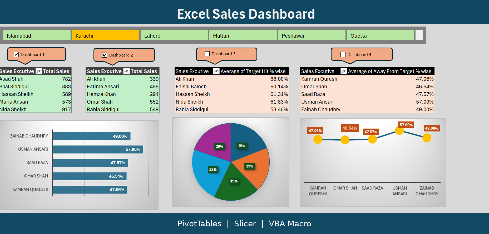
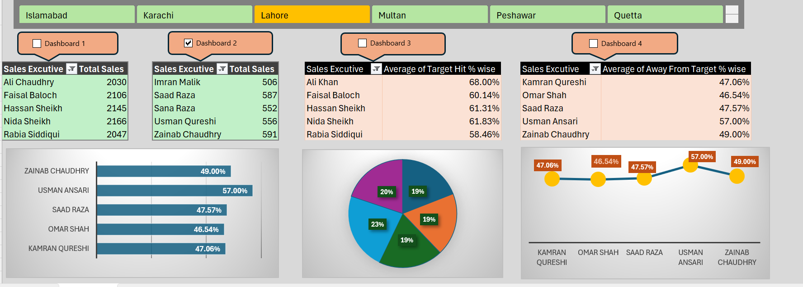

# 📊 Excel Sales Dashboard

An interactive Excel dashboard built with PivotTables, PivotCharts, a Region slicer and a VBA macro that controls which dashboards the slicer filters.

---

## ✨ Features

- 📌 **4 dashboards** showing Sales Executive performance
- 🗺️ **Region slicer** (Islamabad, Karachi, Lahore, Multan, Peshawar, Quetta)
- ☑️ **Dashboard checkboxes** to choose which dashboards the slicer filters
- ⚙️ **VBA macro** to connect or disconnect the slicer from PivotTables
- 📈 **Charts**: bar, pie and line (PivotCharts)
- 🎨 **Custom slicer style** and formatted PivotTables

---

## 📋 Dashboard Overview

| Dashboard | Metric |
|-----------|--------|
| Dashboard 1 | Total Sales by Sales Executive |
| Dashboard 2 | Total Sales by Sales Executive |
| Dashboard 3 | Average of Target Hit % |
| Dashboard 4 | Average of Away From Target % |

---

## 🛠️ Tools Used

- Microsoft Excel
- PivotTables and PivotCharts
- Slicers
- Form Controls (checkboxes)
- VBA (macro: `SlicerConnection`)

---

## ⚙️ How It Works

1. Each checkbox is linked to a cell (A1, D1, G1, J1) that holds `TRUE` or `FALSE`.
2. The macro `SlicerConnection` reads these cells.
3. If a cell is `TRUE`, the Region slicer is connected to that dashboard's PivotTable. If `FALSE`, it is disconnected.

---

## 🚀 How to Use

1. Download `Project_Dashboard.xlsm`.
2. Open it in Excel and click **Enable Content** (required for the macro to run).
3. Tick the dashboards you want to filter.
4. Select a region in the slicer.

---

## 📸 Screenshots

---

## 👩‍💻 Author

**Malaika Saleem**
Computer Science student | Aspiring Data Analyst

🔗 GitHub: [malaika-saleem284](https://github.com/malaika-saleem284)
💼 LinkedIn: [Malaika Saleem](https://www.linkedin.com/in/malaika-saleem-311030428)
